<div align="center">

# 🚀 LeadPulse — Smart B2B Lead Generation & AI Business Intelligence

**Discover → Scrape → Clean → Enrich → Research → Close**

[](https://python.org)
[](https://fastapi.tiangolo.com)
[](https://playwright.dev)
[](https://docker.com)
[](./test_full_suite.py)
[](https://github.com/Pawandubey11/lead-Generation)

</div>

---

## 📌 What Is LeadPulse?

**LeadPulse** is a local-first, full-stack B2B lead generation and sales intelligence platform. It automatically discovers businesses on Google Maps, extracts their contact data, cleans and scores every lead, and then uses AI to research each company — identifying the best SystemaOps services to offer and generating ready-to-send outreach for your sales team.

> Built for **SystemaOps** sales teams who need researched, actionable business opportunities — not just raw contact lists.

---

## 🗺️ System Architecture — Full End-to-End Flow

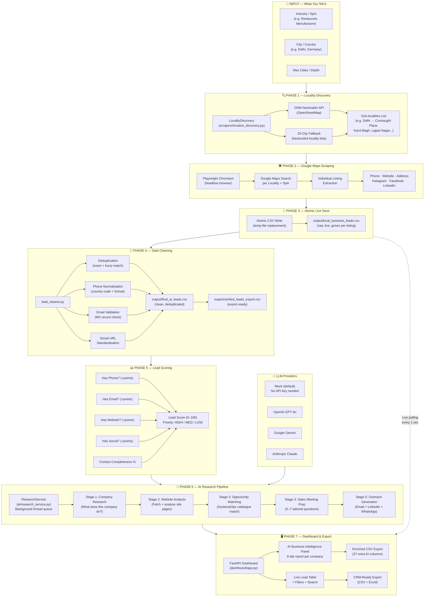

---

## 🔄 Data Pipeline — Step by Step

### Step 1 — Locality Discovery

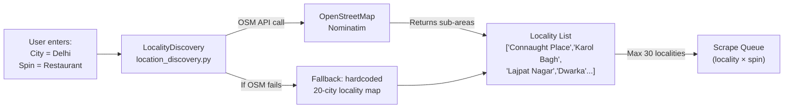

**What happens:**
- Calls OpenStreetMap Nominatim to find real sub-districts of the target city
- Falls back to a built-in list of 20 major Indian/global cities
- Caps at `MAX_LOCALITIES=30` per city to prevent runaway scrapes
- Each locality+spin combination becomes its own scrape job

---

### Step 2 — Playwright Google Maps Scraping

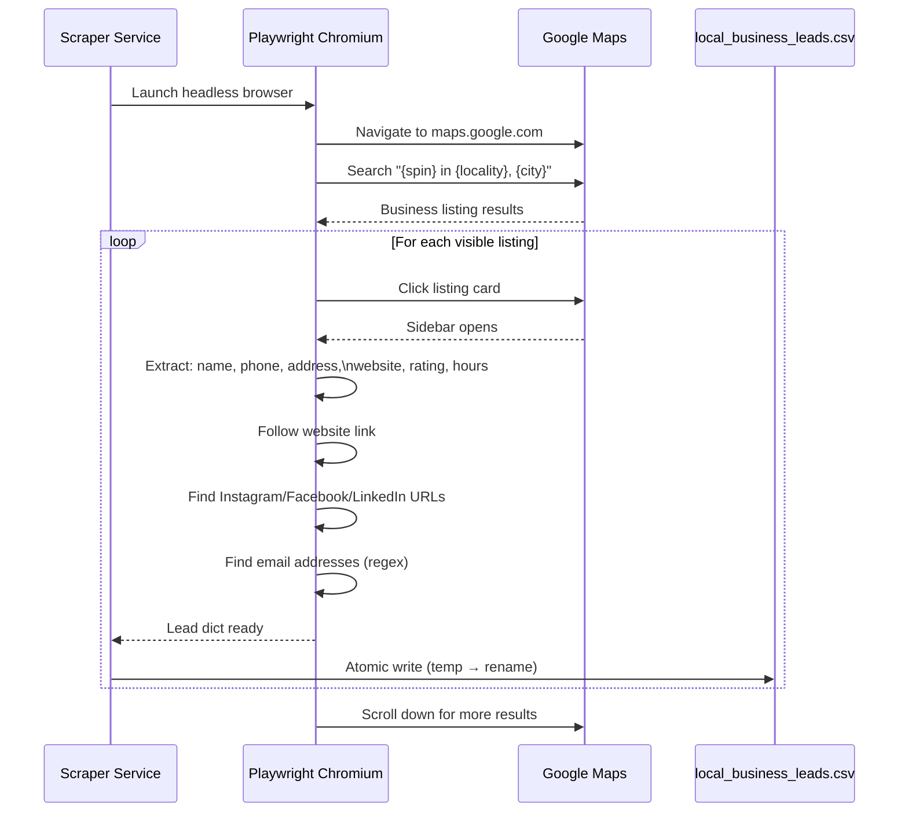

**What is extracted per lead:**
| Field | Source |
|-------|--------|
| `business_name` | Maps listing title |
| `phone` | Maps sidebar |
| `address` | Maps sidebar |
| `website` | Maps sidebar → followed |
| `email` | Website page scan (regex) |
| `instagram` | Website footer/links |
| `facebook` | Website footer/links |
| `linkedin` | Website footer/links |
| `city`, `spin` | From the search query |
| `scraped_at` | Timestamp |

---

### Step 3 — Atomic Save (Live Results)

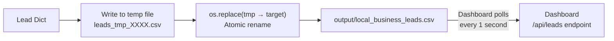

> **Why atomic?** The dashboard reads the CSV at the same time the scraper writes it. A direct write could corrupt a half-written file. Atomic rename (`os.replace`) is instantaneous — the file is either the old version or the fully new version, never broken.

---

### Step 4 — Data Cleaning (`lead_cleaner.py`)

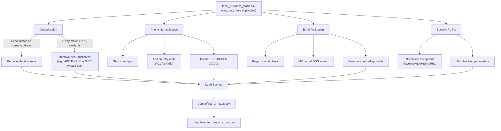

---

### Step 5 — Lead Scoring Engine

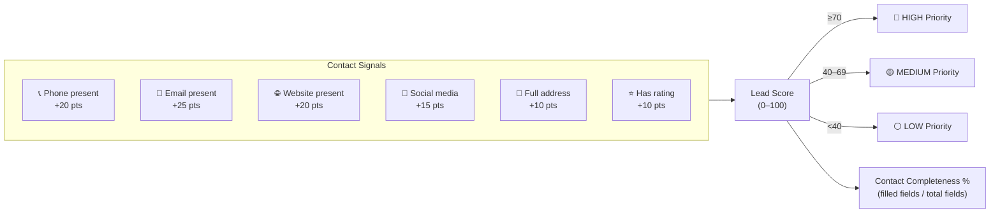

---

### Step 6 — AI Research Pipeline

This is the **SystemaOps intelligence engine**. After leads are generated, your sales team selects companies to research.

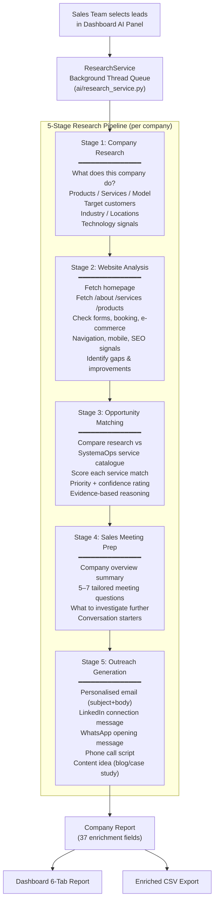

---

### Step 7 — SystemaOps Service Catalogue Matching

The AI compares each company's research findings against **6 service categories**:

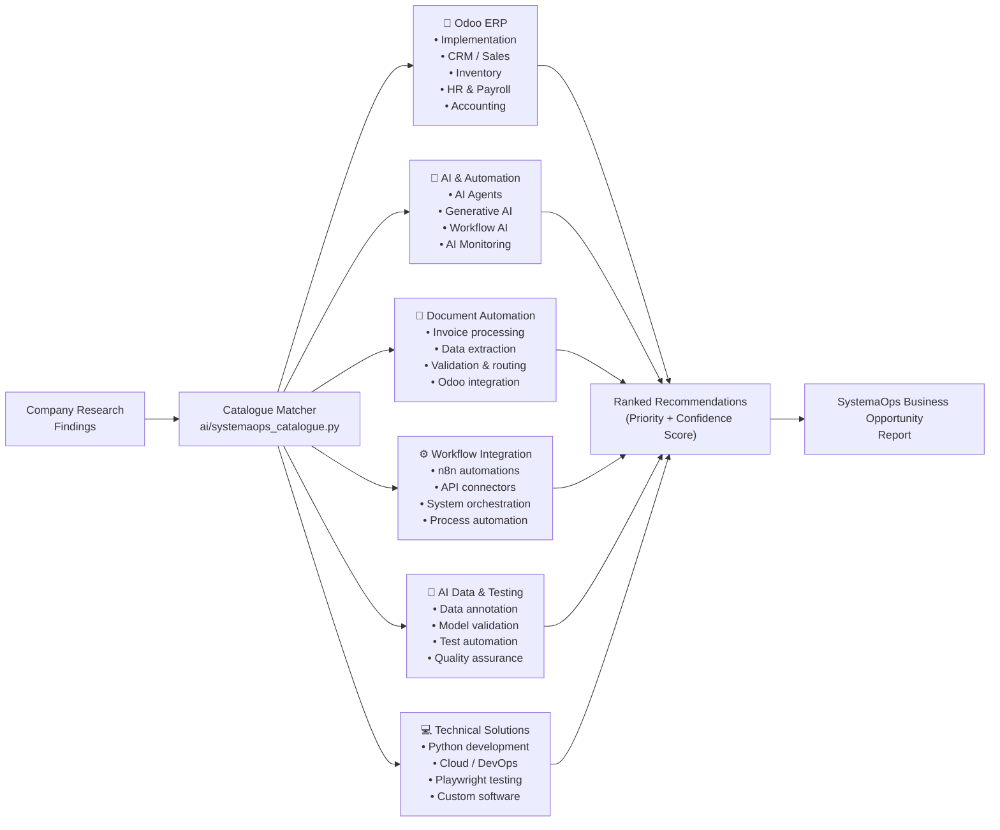

**Matching rules enforced by the AI:**
- ✅ Only recommend services where there is clear evidence
- ✅ Highest-value opportunity listed first
- ✅ Explain the specific business value
- ❌ Never recommend all services to every company
- ❌ Never invent company data
- ❌ Never confuse a hypothesis with a confirmed problem

---

## 🖥️ Dashboard UI Layout

```mermaid
flowchart TD
    subgraph PAGE["Dashboard — http://localhost:8000"]
        H["🔑 Login / Auth Header"]
        
        subgraph S1["Step 1 — Scraper Controls"]
            SC1["Industry spin input\n(Restaurant, Hospital, Factory...)"]
            SC2["City / Country selector"]
            SC3["Max cities + depth"]
            SC4["▶ Start Scrape  ■ Stop Scrape"]
            SC5["📊 Live status bar\n(localities progress, leads found)"]
        end
        
        subgraph AI_PANEL["🤖 AI Business Intelligence Panel"]
            AI1["Lead selection table\n(checkbox per lead)"]
            AI2["Select All  |  ▶ Start Research\n⬇ Export Enriched CSV"]
            AI3["Progress bar + status counters\n(Selected / In Queue / Completed / Failed)"]
            AI4["Per-company status badges\n(idle / researching / done / failed)"]
            AI5["View → (opens 6-tab report modal)"]
        end
        
        subgraph TABS["6-Tab Company Report"]
            T1["Overview\n(company description, industry,\nbusiness model, tech signals)"]
            T2["Website\n(problems, missing elements,\nimprovement list)"]
            T3["Opportunity\n(matched SystemaOps services,\npriority, confidence)"]
            T4["Meeting Prep\n(company summary +\n5-7 tailored questions)"]
            T5["Outreach\n(email / LinkedIn / WhatsApp /\ncall script — all copyable)"]
            T6["Content\n(blog topic, case study angle,\ncall to action)"]
        end
        
        subgraph S2["Step 2 — Lead Filters"]
            F1["Search by name/phone/email"]
            F2["Filter: Industry / City / Priority"]
            F3["Filter: Has Email / Has Website"]
            F4["Date range filter"]
        end
        
        subgraph S3["Step 3 — Lead Table & Export"]
            LT["Paginated lead table"]
            EX["⬇ Export CSV  ⬇ Export Excel"]
            CRM["CRM-ready column headers"]
        end
        
        H --> S1 --> AI_PANEL --> TABS
        AI_PANEL -.-> S2 --> S3
    end
```

---

## 📁 Project Structure

```
lead Generation/
│
├── 📂 ai/                          # AI Research Engine
│   ├── __init__.py
│   ├── systemaops_catalogue.py     # Service catalogue + matching logic
│   ├── llm_client.py               # OpenAI / Gemini / Anthropic / Mock
│   ├── prompts.py                  # 5 system prompts + prompt builders
│   ├── research_engine.py          # 5-stage pipeline per company
│   └── research_service.py        # Thread queue, start/stop/retry
│
├── 📂 scrapers/                    # Data Collection Layer
│   ├── crawler.py                  # Playwright Google Maps crawler
│   ├── location_discovery.py       # City → locality auto-discovery
│   ├── email_extractor.py          # Email regex + website scan
│   ├── website_scraper.py          # Company website fetcher
│   └── utils.py                    # Shared scraper utilities
│
├── 📂 dashboard/                   # Web Application
│   ├── app.py                      # FastAPI routes (all endpoints)
│   ├── ai_service.py               # AI integration layer
│   ├── dashboard_service.py        # Lead loading, filtering, scoring
│   ├── scraper_service.py          # Scraper control + status tracking
│   ├── templates/index.html        # Single-page dashboard UI
│   ├── static/css/style.css        # Styles incl. AI panel
│   ├── static/js/dashboard.js      # All frontend JS
│   └── requirements.txt            # Dashboard dependencies
│
├── 📂 database/                    # Authentication Layer
│   ├── auth_db.py                  # SQLite user auth (bcrypt passwords)
│   ├── mongodb.py                  # Optional MongoDB connector
│   └── schemas.py                  # Pydantic data schemas
│
├── 📂 config/                      # Configuration
│   ├── config.py                   # CSV paths, headers, n8n webhook
│   └── constants.py                # Shared constants
│
├── 📂 output/                      # Generated CSV Files
│   ├── local_business_leads.csv    # Raw live leads (grows during scrape)
│   ├── final_ai_leads.csv          # Cleaned + scored leads
│   └── verified_leads_export.csv   # Export-ready leads
│
├── 📂 docs/                        # Architecture diagrams
├── 📂 audit/                       # Detailed audit reports (10 files)
├── 📂 tests/                       # Automated test suite
│
├── lead_cleaner.py                 # Standalone data cleaning script
├── main.py                         # CLI entrypoint
├── docker-compose.yml              # Full Docker stack
├── Dockerfile                      # Root Dockerfile
├── requirements.txt                # Python dependencies
├── .env.example                    # Environment variable template
├── test_full_suite.py              # 99 offline tests
├── test_live_api.py                # 14 live HTTP tests
└── test_ai_core.py                 # 6 AI module tests
```

---

## 🚀 Quick Start

### Option 1 — Local (Recommended for Development)

```powershell
# 1. Clone the repository
git clone https://github.com/Pawandubey11/lead-Generation.git
cd "lead Generation"

# 2. Create virtual environment
python -m venv .venv
.\.venv\Scripts\Activate.ps1

# 3. Install dependencies
pip install -r requirements.txt
pip install -r requirements-dev.txt

# 4. Install Playwright browser
.\.venv\Scripts\playwright.exe install chromium

# 5. Start the dashboard
cd dashboard
$env:PYTHONPATH = (Get-Location).Path + "\.."
..\.venv\Scripts\uvicorn.exe app:app --host 0.0.0.0 --port 8000

# 6. Open browser
# http://localhost:8000
```

### Option 2 — Docker (Recommended for Production)

```bash
# 1. Clone the repository
git clone https://github.com/Pawandubey11/lead-Generation.git
cd "lead Generation"

# 2. Configure environment (optional)
cp .env.example .env
# Edit .env to add your LLM API key

# 3. Start with Docker Compose
docker-compose up --build

# 4. Open browser
# http://localhost:8000
```

---

## ⚙️ Configuration Reference

### Environment Variables (`.env` file)

```dotenv
# ─── AI Provider ───────────────────────────────────────────
# Default: mock (no API key required, generates sample reports)
AI_PROVIDER=mock           # mock | openai | gemini | anthropic
AI_MODEL=gpt-4o-mini       # model name for chosen provider

# ─── API Keys (only needed for real AI) ────────────────────
OPENAI_API_KEY=sk-...
GEMINI_API_KEY=AIza...
ANTHROPIC_API_KEY=sk-ant-...

# ─── Scraper Limits ────────────────────────────────────────
MAX_LOCALITIES=30          # max sub-areas per city
MAX_BIZ_PER_LOCALITY=20    # max listings per locality

# ─── n8n Webhook (optional) ────────────────────────────────
N8N_WEBHOOK_URL=https://your-n8n.com/webhook/...
N8N_WEBHOOK_SECRET=your-secret
N8N_SEND_ON_COMPLETION=true

# ─── Dashboard Auth ────────────────────────────────────────
SECRET_KEY=change-this-to-a-random-secret
```

### AI Provider Comparison

| Provider | Speed | Quality | Cost | Setup |
|----------|-------|---------|------|-------|
| **Mock** (default) | ⚡ Instant | Sample data | Free | None |
| **OpenAI GPT-4o-mini** | 🚀 Fast | ⭐⭐⭐⭐ | \$0.15/1M tokens | API key |
| **Google Gemini 1.5 Flash** | 🚀 Fast | ⭐⭐⭐⭐ | Free tier available | API key |
| **Anthropic Claude Haiku** | 🚀 Fast | ⭐⭐⭐⭐ | \$0.25/1M tokens | API key |

---

## 🔌 API Reference

### Scraper Endpoints

| Method | Endpoint | Description |
|--------|----------|-------------|
| `GET` | `/` | Dashboard HTML |
| `GET` | `/api/health` | Health check |
| `GET` | `/api/stats` | Total lead counts |
| `GET` | `/api/spins` | Available industry categories |
| `GET` | `/api/leads` | Paginated lead list (with filters) |
| `POST` | `/api/scrape/start` | Start scraping job |
| `POST` | `/api/scrape/stop` | Stop scraping job |
| `GET` | `/api/scrape/status` | Live scrape status |
| `GET` | `/api/scrape/coverage` | Locality coverage stats |
| `POST` | `/api/locality/discover` | Discover localities for a city |
| `GET` | `/api/export/csv` | Export filtered leads as CSV |
| `GET` | `/api/export/excel` | Export filtered leads as Excel |

### AI Business Intelligence Endpoints

| Method | Endpoint | Description |
|--------|----------|-------------|
| `GET` | `/api/ai/config` | AI provider + model info |
| `GET` | `/api/ai/status` | Queue state, progress counters |
| `POST` | `/api/ai/research/start` | Start AI research (body: `{"business_names":[...]}`) |
| `POST` | `/api/ai/research/stop` | Stop ongoing research |
| `POST` | `/api/ai/research/retry` | Retry failed companies |
| `GET` | `/api/ai/reports` | All completed report summaries |
| `GET` | `/api/ai/report/{name}` | Full 37-field report for one company |
| `GET` | `/api/ai/export/enriched` | Download enriched CSV (original + 37 AI cols) |
| `GET` | `/docs` | Interactive Swagger UI |

---

## 📊 Enriched CSV Columns (37 AI Fields Added)

After AI research, the exported CSV includes these additional columns:

| Column | Description |
|--------|-------------|
| `research_status` | idle / researching / done / failed |
| `research_timestamp` | When research completed |
| `company_description` | What the company does |
| `industry` | Detected industry |
| `business_model` | B2B / B2C / hybrid etc. |
| `products_services` | Main offerings |
| `target_customers` | Who they sell to |
| `locations` | Operating areas |
| `technology_signals` | Detected tech stack signals |
| `digital_channels` | Online presence channels |
| `website_available` | true / false |
| `website_overview` | Website summary |
| `website_existing_features` | What the site already has |
| `website_positives` | Good elements |
| `website_problems` | Issues found |
| `website_missing` | Missing elements |
| `website_improvements` | Recommended improvements |
| `recommended_systemaops_services` | Matched service IDs |
| `strongest_business_opportunity` | #1 recommended service |
| `opportunity_reason` | Why this service fits |
| `evidence` | Supporting evidence |
| `potential_business_challenge` | Problems they may face |
| `expected_business_benefit` | Business value of the solution |
| `opportunity_priority` | HIGH / MEDIUM / LOW |
| `recommendation_confidence` | HIGH / MEDIUM / LOW |
| `systemaops_business_opportunity` | Plain-language opportunity summary |
| `company_understanding` | Meeting prep overview |
| `meeting_questions` | 5–7 tailored questions |
| `what_to_investigate` | Unknowns to confirm |
| `email_subject` | Ready-to-send email subject |
| `email_body` | Ready-to-send email body |
| `linkedin_message` | LinkedIn connection note |
| `whatsapp_message` | WhatsApp opener |
| `call_script` | Phone call script |
| `blog_topic` | Content marketing idea |
| `case_study_angle` | Case study framing |
| `call_to_action` | Suggested next step |

---

## 🏢 SystemaOps Service Catalogue

The AI only recommends services from this verified catalogue:

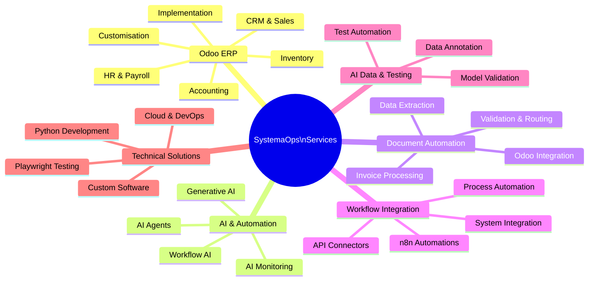

---

## 🔐 Security

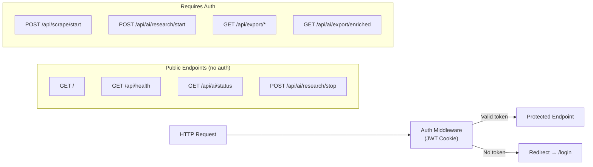

- Passwords hashed with **bcrypt** (12 rounds)
- Sessions via **HTTPOnly JWT cookies**
- HMAC-signed scrape tokens
- No API secrets exposed in `/api/ai/config`

---

## 🧪 Running Tests

```powershell
# Full offline test suite (99 tests, no server needed)
.\.venv\Scripts\python.exe test_full_suite.py

# Live API tests (server must be running on :8000)
.\.venv\Scripts\python.exe test_live_api.py

# AI module unit tests
.\.venv\Scripts\python.exe test_ai_core.py

# Locality discovery tests
.\.venv\Scripts\python.exe test_locality2.py
```

**Expected results:**

| Test File | Tests | Expected |
|-----------|-------|----------|
| `test_full_suite.py` | 99 | ✅ 99 / 99 PASSED |
| `test_live_api.py` | 14 | ✅ 14 / 14 PASSED |
| `test_ai_core.py` | 6 | ✅ 6 / 6 PASSED |
| `test_locality2.py` | 8 | ✅ 8 / 8 PASSED |

---

## 📈 How to Use — Step by Step

### 1. Generate Leads

1. Open `http://localhost:8000`
2. Enter your **industry** (e.g., `manufacturer`, `hospital`, `restaurant`)
3. Enter your **city** (e.g., `Delhi`, `Mumbai`)
4. Set **max cities** and **listing depth**
5. Click **▶ Start Scrape**
6. Watch leads appear in the table in real time

### 2. Research Companies with AI

1. Scroll to the **🤖 AI Business Intelligence** panel
2. Check the boxes next to companies you want to research
3. Click **▶ Start Research**
4. Watch the progress bar — each company goes through 5 research stages
5. When complete, click **View →** next to any company

### 3. Review the 6-Tab Report

| Tab | What You Get |
|-----|-------------|
| **Overview** | What the company does, industry, tech signals |
| **Website** | Problems found, missing features, improvements |
| **Opportunity** | Which SystemaOps services fit + why |
| **Meeting Prep** | Company summary + tailored questions |
| **Outreach** | Ready email, LinkedIn, WhatsApp, call script |
| **Content** | Blog/case study ideas |

### 4. Export and Use

- Click **📋 Copy** on any outreach message to copy to clipboard
- Click **⬇ Export Enriched CSV** for a full dataset with all 37 AI fields
- Use the standard **Export CSV / Excel** for the original lead data

---

## 🐳 Docker Architecture

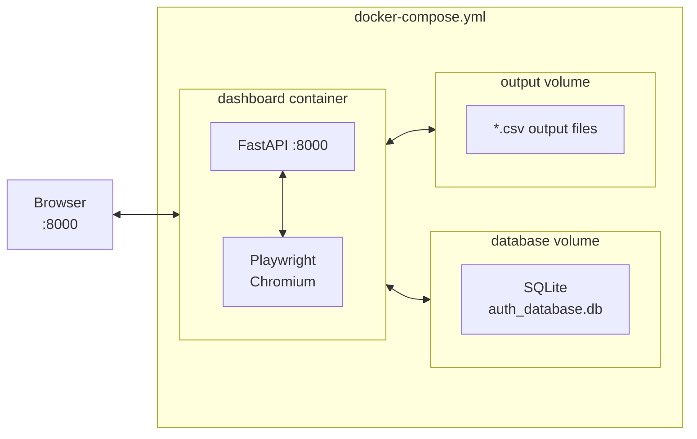

```yaml
# Key docker-compose environment variables
environment:
  - AI_PROVIDER=mock          # or openai / gemini / anthropic
  - AI_MODEL=gpt-4o-mini
  - OPENAI_API_KEY=           # your key here
  - GEMINI_API_KEY=           # your key here
  - ANTHROPIC_API_KEY=        # your key here
  - MAX_LOCALITIES=30
  - MAX_BIZ_PER_LOCALITY=20
```

---

## 📌 Git History

```
19c2cd5  fix: remove __future__ annotations + BOM cleanup — 14/14 live tests ✅
fe8da8f  feat: add SystemaOps business opportunity intelligence to main
efeb60a  Merge feature/systemaops-business-opportunity-intelligence into main
4df60f3  fix: support current Starlette template rendering
b7100bd  Merge pull request #1 from Pawandubey11/feature/project-intelligent-enhancements
36c4821  fix: restore local exports and live city metadata
c437a12  feat: improve security, password migration, scrape depth
fbf84d3  docs: add project architecture graphic
```

---

## 🤝 Contributing

1. Fork the repository
2. Create a feature branch: `git checkout -b feature/my-feature`
3. Make changes and add tests
4. Run the full test suite: `.\.venv\Scripts\python.exe test_full_suite.py`
5. Commit: `git commit -m "feat: describe your change"`
6. Push: `git push origin feature/my-feature`
7. Open a Pull Request

---

## 📄 License

This project is proprietary software developed for **SystemaOps**.  
© 2026 SystemaOps. All rights reserved.

---

<div align="center">

**Built with ❤️ for the SystemaOps sales team**

[🌐 SystemaOps Website](https://www.systemaops.com) · [📦 GitHub](https://github.com/Pawandubey11/lead-Generation) · [📖 API Docs](http://localhost:8000/docs)

</div>
