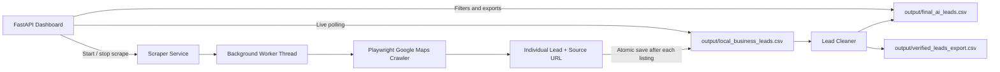
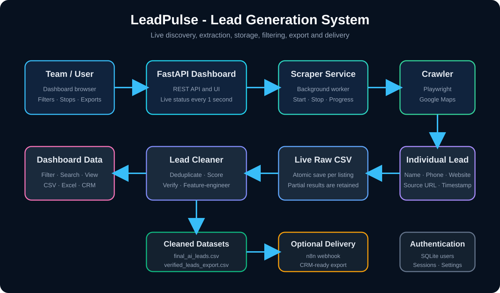

# LeadPulse Lead Generation

LeadPulse is a local-first lead discovery and enrichment dashboard. It searches public business listings, extracts contact information and social profiles, saves results incrementally, and provides filtering and CRM-ready CSV/Excel exports.

The project is designed for researchers, sales teams, and developers who need an auditable dataset and immediate access to leads while a crawl is still running.

## Key capabilities

- Live Google Maps business discovery through Playwright
- Country or city-based targeting
- Incremental lead saving after every extracted listing
- Live discovered-lead counter and crawler status
- Dashboard access while a crawl continues in the background
- Partial results preserved when crawling is stopped or interrupted
- Lead scoring, email, phone, website, social, and completeness data
- Search, industry, city, country, priority, and date filters
- CSV and Excel exports
- SQLite authentication and user settings
- Optional Docker deployment
- Optional n8n webhook delivery

## How it works



### Live data flow

1. The dashboard sends a start request to `/api/scrape/start`.
2. A daemon background thread runs the Playwright crawler.
3. Each listing is converted into a lead and saved immediately.
4. The raw live CSV is updated with an atomic temporary-file replacement.
5. The dashboard polls status and reloads the live dataset every second.
6. Leads remain available after refresh, stop, interruption, or browser restart.

This means the application does not wait for every city or the entire crawl to finish before displaying discovered leads.

## Project overview graphic



## Screenshot and UI areas

The dashboard includes:

- Target industry and location controls
- Maximum-city configuration
- Live crawl status, progress, city, and run-lead counter
- Search and verified-lead filters
- Live lead table
- Configurable CSV/Excel fields
- Latest-run and filtered exports

## Requirements

### Local Windows setup

- Windows 10 or 11
- Python 3.11 or 3.13
- PowerShell
- Internet access
- Chromium, installed automatically by `setup.ps1`

Docker Desktop is optional and only required for the Docker workflow.

## Quick start on Windows

```powershell
git clone https://github.com/Pawandubey11/lead-Generation.git
cd lead-Generation

.\setup.ps1
.\run-dashboard.ps1
```

Open <http://127.0.0.1:8000>.

`setup.ps1` performs the following:

- Creates `.venv`
- Upgrades pip
- Installs project dependencies
- Installs Chromium for Playwright
- Copies `.env.example` to `.env` when needed

PowerShell execution policy may need to allow local scripts:

```powershell
Set-ExecutionPolicy -Scope Process -ExecutionPolicy Bypass
```

## Run the scraper from the dashboard

1. Enter a target industry, for example `car selling`, `dentist`, or `law firms`.
2. Enter a city or country, for example `Pune` or `India`.
3. Choose the maximum number of cities.
4. Start the crawl.
5. View and filter leads while extraction continues.
6. Stop the crawl at any time; existing partial leads remain available.

For city/country pairs, use:

```text
Bihar, India
```

The scraper separates the city and country parts for filtering and the country crawler.

## Run the scraper from PowerShell

```powershell
.\run-scraper.ps1 -BusinessType "gym" -Country "india" -MaxCities 30
```

This executes [main.py](main.py) with the supplied arguments.

## Faster scraping

Set environment variables before starting the dashboard or running the CLI:

```powershell
$env:QUICK_SCRAPE="true"
$env:MAX_BIZ_PER_CITY="10"
.\run-dashboard.ps1
```

These variables control crawl cost:

- `QUICK_SCRAPE=true` reduces scroll passes and fixed waits.
- `MAX_BIZ_PER_CITY` limits listings opened in each city.

Recommended starting values:

| Mode | Scroll passes | Listings per city |
|---|---:|---:|
| Quick | 2 | 10 |
| Normal | 30 | 20 |
| Custom | Configured | `MAX_BIZ_PER_CITY` |

Actual runtime also depends on network quality, consent handling, Google Maps, and website response time.

## Docker quick start

Docker Desktop must be running.

Start the dashboard:

```powershell
docker compose up --build dashboard
```

Open <http://localhost:8000>.

Run the crawler interactively:

```powershell
docker compose run --rm leadgen
```

Example non-interactive Compose variables:

```yaml
environment:
  - LEADPULSE_BUSINESS_TYPE=gym
  - LEADPULSE_COUNTRY=india
  - LEADPULSE_MAX_CITIES=30
  - QUICK_SCRAPE=true
  - MAX_BIZ_PER_CITY=10
```

## Project structure

```text
lead-Generation/
├── main.py                     CLI and crawl orchestration entry point
├── lead_cleaner.py             Deduplication, scoring, cleaning, exports
├── batch_scraper.py            Repeated niche/city scraping utility
├── scrape_germany_b2b.py       Germany-oriented batch workflow
├── setup.ps1                   Windows dependency setup
├── run-dashboard.ps1           Start the FastAPI dashboard
├── run-scraper.ps1             Start the scraper CLI
├── requirements.txt            Shared Python dependencies
├── docker-compose.yml          Dashboard and crawler services
│
├── dashboard/
│   ├── app.py                  FastAPI routes and dashboard server
│   ├── scraper_service.py      Background thread and live status
│   ├── dashboard_service.py    Live CSV loading, filtering, exports
│   ├── static/js/dashboard.js  Browser live polling and UI behavior
│   ├── templates/index.html    Dashboard markup
│   └── static/css/style.css    Dashboard styling
│
├── scrapers/
│   ├── crawler.py              Playwright Google Maps crawler
│   ├── email_extractor.py      Email extraction helpers
│   ├── website_scraper.py      Website-level scraping helpers
│   └── utils.py                Shared crawler utilities
│
├── database/
│   ├── auth_db.py              SQLite authentication
│   ├── mongodb.py              Optional MongoDB integration
│   └── schemas.py              Data schemas
│
├── config/
│   ├── config.py               n8n and runtime configuration
│   ├── constants.py            Shared constants
│   └── google_cookies.json     Optional local Google cookies
│
└── output/
    ├── local_business_leads.csv     Incremental live/raw results
    ├── final_ai_leads.csv           Cleaned dashboard dataset
    ├── verified_leads_export.csv    Filtered verified export
    └── progress.txt                 Resume tracking during an active crawl
```

## Output files

| File | Purpose |
|---|---|
| `output/local_business_leads.csv` | Raw incremental results saved after each listing |
| `output/final_ai_leads.csv` | Cleaned and scored dashboard dataset |
| `output/verified_leads_export.csv` | Verified/high-completeness exported leads |
| `output/progress.txt` | Tracks completed cities for resume support |

Generated files are excluded from Git by `.gitignore`. Do not commit lead datasets or databases to a public repository.

## Lead provenance

New leads include provenance fields:

- `source_name`: source platform, currently `Google Maps`
- `source_url`: direct listing URL
- `scraped_at`: timestamp for extraction
- `spin`: industry, location, and run timestamp

A lead's source URL allows the team to reopen and validate the original listing. An automatically extracted phone number or email is not a guarantee of current or decision-maker accuracy.

## Configuration

Copy `.env.example` to `.env` for persistent settings.

```dotenv
LEADPULSE_SECRET_KEY=change-this-to-a-random-64-character-secret
SENDER_NAME=
SENDER_TITLE=
SENDER_COMPANY=
N8N_WEBHOOK_URL=
N8N_WEBHOOK_SECRET=
N8N_SEND_ON_COMPLETION=false
```

Environment variables for optional Google consent handling:

```text
GOOGLE_COOKIES_PATH
LEADS_CSV_PATH
QUICK_SCRAPE
MAX_BIZ_PER_CITY
LEADPULSE_BUSINESS_TYPE
LEADPULSE_COUNTRY
LEADPULSE_MAX_CITIES
N8N_WEBHOOK_URL
N8N_WEBHOOK_SECRET
N8N_SEND_ON_COMPLETION
```

Never commit:

- `.env`
- `config/google_cookies.json`
- `database/auth_database.db`
- `output/*.csv`
- Scraped HTML, screenshots, or lead backups

## API overview

| Method | Endpoint | Purpose |
|---|---|---|
| `GET` | `/api/health` | Health and CSV availability |
| `POST` | `/api/scrape/start` | Start a background crawl |
| `GET` | `/api/scrape/status` | Live crawl status and counter |
| `POST` | `/api/scrape/stop` | Stop after the current operation |
| `GET` | `/api/leads` | Paginated live and cleaned leads |
| `GET` | `/api/dashboard` | Consolidated dashboard response |
| `GET` | `/api/export/csv` | Download CSV |
| `GET` | `/api/export/excel` | Download Excel |
| `GET` | `/api/export/custom` | Download selected fields |

Interactive API documentation is available at:

- <http://127.0.0.1:8000/docs>
- <http://127.0.0.1:8000/redoc>

## Stopping, refreshing, and resuming

- Stop requests finish the current browser operation, then preserve partial results.
- Every extracted lead is written immediately to `local_business_leads.csv`.
- Refreshing the browser reloads existing and partial leads.
- Completed city names are tracked in `progress.txt`.
- Restarting a crawl does not intentionally remove existing lead files.
- A new run should use a distinct industry/location or timestamp to prevent older results from being confused with the latest run.

## Troubleshooting

### Python or dependency problems

```powershell
python --version
.\setup.ps1
```

Use Python 3.11 or 3.13 for the most reliable dependency compatibility.

### Chromium is missing

```powershell
.\.venv\Scripts\python.exe -m playwright install chromium
```

### Dashboard has no leads

1. Check <http://127.0.0.1:8000/api/health>.
2. Confirm `output/local_business_leads.csv` or `output/final_ai_leads.csv` exists.
3. Reset filters, especially Industry and City.
4. Select `Reload Leads`.

### Google consent or blocking occurs

- A real browser session may require consent handling.
- Google Maps can block automated or datacenter traffic.
- Optional cookies must remain local and must not be committed.
- Use lower concurrency and reasonable crawl limits.

### PowerShell blocks scripts

```powershell
Set-ExecutionPolicy -Scope Process -ExecutionPolicy Bypass
```

### Docker is unavailable

Use the local Windows setup instead:

```powershell
.\setup.ps1
.\run-dashboard.ps1
```

## Responsible use

Only collect data you are authorized to use. Review the terms and restrictions of every source before deployment. Do not publish credentials, private information, generated datasets, or protected personal data. Add final human validation before outreach or business decisions.
